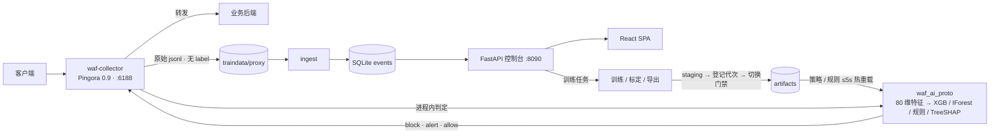

# hiwaf · CPU-only AI WAF

> 面向中小业务的边缘 WAF：**Rust 数据面**（Pingora 反向代理 + ONNX Runtime）+
> **Python 控制面**（训练 / 标定 / 控制台）。纯 CPU 上完成
> 「规则 + 监督模型 + 零日异常」三通道判定，毫秒级延迟，并带完整的
> 训练 → 登记 → 切换门禁 → 热重载闭环。

`Python 3.10` · `Rust 1.99` · `Node 18+` · `ONNX Runtime 1.20` · `AGPL-3.0-or-later`

---

## 目录

- [为什么做这个](#为什么做这个)
- [核心能力](#核心能力)
- [架构](#架构)
- [当前状态](#当前状态)
- [快速开始](#快速开始)
- [目录结构](#目录结构)
- [训练与上线](#训练与上线)
- [测试与门禁](#测试与门禁)
- [文档导航](#文档导航)
- [设计红线](#设计红线)
- [已知限制](#已知限制)
- [许可](#许可)
- [第三方与数据](#第三方与数据)

---

## 为什么做这个

中小业务在 WAF 上通常只有两个选择：

- **传统规则 WAF**：已知攻击拦得准，但变种、编码绕过、未知威胁基本靠运气；
- **商用 AI WAF**：多为云端 GPU 方案，成本高、延迟大，且流量必须出域。

本项目把 AI 检测放回**自己的机器**上：纯 CPU、单进程、可解释、可回滚。它不是"用模型替代规则"，
而是让**规则与模型并列**——规则负责可证明的已知攻击，监督模型负责已知攻击的变种与分类，
零日通道负责"没见过"的异常（只告警，不单独阻断）。

## 核心能力

### 三通道判定

| 通道 | 模型 / 依据 | 分数定义 | 单独动作 |
|---|---|---|---|
| 监督 | XGBoost 多分类（80 维特征） | `1 - P(normal)` | **block** |
| 规则 | 自撰规则集（权重 + 阻断线） | 命中规则权重和 | **block**（达到阻断线时） |
| 零日 | Isolation Forest（精简 ONNX） | `-avg_path_len` | **alert only**（永不单独阻断） |

融合顺序：监督命中 → `block`；规则权重和 ≥ 阻断线 → `block`；
仅零日命中、或规则有命中但不够阻断线 → `alert`（人工复核）；否则 `allow`。

> 零日通道的误报语义是"没见过"，而不是"确认是攻击"，所以结构上不允许它单独阻断。
> 顶层 `zero_day_enabled=false` 时它**不参与融合**，但分数与原始穿阈仍然计算留证。

### 数据面

- Pingora 0.9 反向代理（rustls，不依赖 OpenSSL），HTTP + 流级双路采集；
- `request_body_filter` 拿到完整请求体（access log 拿不到的最强特征）；
- 判定在 `logging` 阶段完成，不占真实请求延迟；
- 策略 / 规则集 ≤5s 热重载，换模型才需要重启；
- 三种模式：`off`（纯采集）/ `dry_run`（只记录）/ `enforce`（命中返回 403）。

### 控制台

单端口托管的 React SPA（FastAPI 同时提供 API 与 `web/dist`），**15 个业务页面 + 登录页**：

总览（站点→模型）· 事件（取证包 / TreeSHAP）· 告警（聚合 + 攻击链 + 服务端搜索/筛选）·
抑制策略 · 策略中心 · 反馈台账 · 规则管理（四层生命周期 + 三级熔断）· 模型与门禁（代际树 / 学习曲线）·
训练数据（上传 / 事件选择）· 训练任务 · 降级状态 · 采集代理 · 审计 · 用户管理 · IP 黑白名单。

RBAC：`viewer < analyst < admin`；JWT + PBKDF2；全部写操作落审计。

## 架构



```text
客户端 ──► 采集器 :6188 ──► 真实后端
              │
              ├─► traindata/proxy/raw-*.jsonl   （原始记录，无 label）
              └─► 判定：监督 → block / 规则 → block / 零日 → alert
                        │
                        └─► SQLite events ──► 控制台（事件 / 告警 / 规则 / 模型 / 审计）
                                                  │
                                                  └─► 训练任务 ──► staging ──► 代次登记 ──► 切换门禁
```

**为什么判定代码只有一份**：`rust/` 是 lib `waf_ai_proto` + bin 门禁，`proxy/` 通过 path 依赖复用
同一份 `features.rs` / `decision.rs`。复制一份判定逻辑会让 200×80 逐位一致的门禁失去意义。

## 当前状态

> 以下为 2026-10-30 的现役产物。**唯一事实来源是 `python/artifacts/decision_policy.json`**，
> 本表只是快照。

| 项 | 值 |
|---|---|
| 策略版本 | **v20** |
| 监督通道 | XGBoost **g2**（4000 棵树 / 23,664 节点 / 深度 8），sha `eab7b73e1b04ba0d` |
| 监督阈值 | `0.721004` @ 目标 FPR 1% |
| 零日通道 | IForest **g2**（125 棵树），sha `1a6967a746eaa40e` |
| 零日阈值 | `-7.359740` @ 目标 FPR 1% |
| 零日开关 | `zero_day_enabled = false`（安全降级：分数留证，不产生 alert） |
| 现役规则集 | **91 条 / 41 条 block**，sha `5425465fd0085457` |
| 采集器 | 已加载现役 sha（`in_sync`） |

门禁（`rust/` 一致性 harness，全部通过）：

| 校验项 | 结果 |
|---|---|
| Rust 特征 vs Python v2 | **逐位一致**，200×80 全 0 差异 |
| XGBoost 推理 vs onnxruntime | max\|diff\| ≈ 4.17e-7，argmax 200/200 |
| IForest 推理 | max\|diff\| ≈ 5.7e-6 |
| TreeSHAP vs `pred_contribs` | max\|diff\| ≈ 8.1e-6 |
| 阈值交叉核对 | 0.000e0 |
| 融合动作一致性 | 200/200 |

单请求延迟（release，i5-12500H，含 TreeSHAP；**g1 2000 树口径**，g2 待复测）：
p50 ≈ 0.64 ms / p99 ≈ 1.18 ms。

零日检出率（CSIC 2010，@FPR 1%）：g1 26.0% → **g2 26.6%**。

## 快速开始

### Windows

```bat
install.bat -NoRust          :: 只装控制台（首次会建 .venv、构建前端、初始化 DB）
install.bat -WithRust        :: 连 Rust 判定引擎与采集器一起构建
```

### Linux

```bash
chmod +x install.sh
./install.sh --no-rust
sudo ./install.sh --systemd --port 8090   # 常驻
```

安装完成后打开 <http://127.0.0.1:8090>（接口文档 `/docs`）。首次启动会创建 `admin`，
初始密码在 `python/service/.admin_password`，**登录后立即修改**（强密码策略固定，不能放宽）。

手动启动：

```bash
cd python
python -m service.bootstrap
python -m service.run --host 127.0.0.1 --port 8090
```

> 命令中的路径都相对仓库根目录；下文同样如此。需要训练模型或改 Rust 时见
> [`SETUP.md`](SETUP.md)。

### 让业务流量走代理

```bash
# 单路由：客户端 → 采集器 6188 → 真实后端 127.0.0.1:8080
cd proxy
./build.sh run --release -- --listen 0.0.0.0:6188 --upstream 127.0.0.1:8080 \
    --out ../traindata/proxy --stats-out ../traindata/proxy/collector-metrics.json
```

控制台「采集代理」页也可以启停/改配置（admin）。默认 `block_mode=off` 纯采集，
确认阈值在本地良性流量上标定后再切 `enforce`。

## 目录结构

```text
.
├─ rust/                 判定引擎：lib waf_ai_proto + bin waf-ai-proto（一致性门禁）
├─ proxy/                采集数据面：crate waf-collector（Pingora 反向代理 + 双路采集）
├─ proxy_spike/          S4 基座验证（Pingora on Windows MSVC），归档保留
├─ python/               控制面：特征 / 训练 / 标定 / 评估 / 上传解析 / 控制台 API
│  ├─ service/           FastAPI + SQLite + RBAC + 审计
│  └─ artifacts/         产物：策略、规则集、模型 meta、testvec、学习曲线
├─ web/                  React 18 + AntD 5 + ECharts（构建产物由 FastAPI 托管）
├─ rules/                外部规则集（导入后仍走同一条人工生命周期）
├─ deploy/               systemd 模板
├─ traindata/            数据集（**不入库**，见 .gitignore）
├─ install.bat / .ps1    一键安装（Windows）
├─ install.sh            一键安装（Linux）
├─ SETUP.md              完整搭建与运维手册
└─ INSTALL.md            一键安装说明
```

`traindata/`、`python/artifacts/models/`、`*.onnx`、`console.db` 等运行态与大文件都在
`.gitignore` 里。**克隆仓库后没有模型二进制**，需要按 `SETUP.md` 训练一次，或从你自己的
发布渠道获取产物。

## 训练与上线

训练**不直接覆盖现役产物**，这是整套系统最重要的工程约束：

```text
训练 → artifacts/staging/task_<id>/        （只写 staging）
     → 自动登记为一代 gen-XXXX-<sha>/      （model_registry + 血缘 + 曲线）
     → 切换门禁（备份 → 写槽位 → 重标定 → testvec → SHAP ref → rust 门禁）
     → 重启采集器（换模型必须重启；只换阈值/规则 ≤5s 热重载）
```

```bash
cd python

# 监督通道：正式配方（真实数据 + 困难良性负样本）
python train_realdata.py --features v2 --hard-neg lexical --export

# 增量训练（warm start）：从上一代继续加树
python train_realdata.py --features v2 --hard-neg lexical --export \
    --parent-model artifacts/models/supervised/gen-0001-<sha>/xgb_model.json

# 零日通道
python iforest_lean_onnx.py --data csic --export
python iforest_lean_onnx.py --data csic --export --trees 125 \
    --parent-model artifacts/models/zero_day/gen-0001-<sha>/iforest_model.joblib

# 阈值标定（唯一事实来源）
python thresholds.py --pool csic --fpr 0.01
python export_testvec.py && python export_shap_ref.py
```

> 父代缺训练件（XGBoost 的 `xgb_model.json`、IForest 的 `iforest_model.joblib`）时，
> warm start 会**降级为全量重训**并在任务里写明原因——这是刻意可见的，不会静默假装增量。

## 测试与门禁

| 层 | 命令 | 规模 |
|---|---|---|
| Python 单测 | `cd python && python -m unittest discover -p "test_*.py"` | **279 项** |
| 控制面 API 自检 | `cd python && python -m service.smoke`（需服务已启动） | **39 项** |
| 采集面端到端 | `cd python && python -X utf8 p8_proxy_e2e.py` | **43 项** |
| Rust 判定/熔断守卫 | `cd rust && ./build.sh test --release --lib` | **18 项** |
| 数据目录盘点 | `cd python && python traindata_catalog.py --self-test` | **29 项** |
| 判定一致性门禁 | `cd rust && ./build.sh run --release` | 见[当前状态](#当前状态) |

前端：`cd web && npm run typecheck && npm run build`。

## 文档导航

| 文档 | 内容 |
|---|---|
| [`INSTALL.md`](INSTALL.md) | 一键安装（Windows / Linux）、参数、验证、常见问题 |
| [`SETUP.md`](SETUP.md) | 从零搭建：环境、数据、训练、标定、Rust 门禁、采集器、控制台、全部坑 |
| [`python/README.md`](python/README.md) | 特征、训练、标定、评估、上传解析、脚本清单 |
| [`python/service/README.md`](python/service/README.md) | 控制面 API、模块、数据层、模型代际与切换、自检、待办 |
| [`rust/README.md`](rust/README.md) | 判定引擎、TreeSHAP 移植、一致性校验、已知限制 |
| [`proxy/README.md`](proxy/README.md) | 采集器、落盘 schema、`pred` 语义、接入手册、取舍 |
| [`web/README.md`](web/README.md) | 前端页面、刷新策略、红线 |
| [`ENGINEERING_PLAN.md`](ENGINEERING_PLAN.md) | 工程阶段与风险项状态（S1–S15） |
| [`REALDATA_EVALUATION.md`](REALDATA_EVALUATION.md) | 真实数据评估日志：误报根因、阈值口径、所有数字的出处 |
| [`AI_FEASIBILITY_REPORT.md`](AI_FEASIBILITY_REPORT.md) | AI 方案可行性（历史报告，结论已被真实数据修正） |
| [`prd.md`](prd.md) | 产品需求（需求源，含实现状态横幅） |
| [`THIRD_PARTY_NOTICES.md`](THIRD_PARTY_NOTICES.md) | 第三方组件与数据许可 |
| `traindata/CATALOG.md` | 数据目录盘点（**由脚本生成**，见下） |

> `traindata/CATALOG.md` 是本地生成文件：`cd python && python traindata_catalog.py`
> 会重新扫描 `traindata/` 并写回（只读盘点，不移动/改名/删除任何文件）。

## 设计红线

这些约束写进了代码和测试，改代码时不要绕过：

1. **采集器不打标签**：原始记录里没有 `label`；标签只能来自出处（蜜罐路径 / 红队时间窗 / 人工复核）。
2. **模型输出与训练标签结构性分离**：`parse_jsonl` 只保留已知键，`pred` 不可能变成标签。
3. **默认不阻断**：`block_mode=off`；要拦必须先有真实本地良性流量标定阈值。
4. **阈值不能在界面手改**：只能「选标定池 → 预览 → 提升」，预览写临时文件，不碰现役策略。
5. **零日通道永不单独阻断**：它只产生 alert。
6. **规则启用 ≠ 合格**：启用只进"测试中"（强制 alert）；合格必须人工确认；提升才进数据面。
7. **已验证规则永不自动熔断**：自动熔断只作用于未验证的 alert 规则。
8. **切换模型必须过门禁**：任一步失败全量回滚，没有绕门禁的快速恢复。
9. **策略 / testvec / Rust 三件套必须同源重生成**，否则门禁或采集器启动即报错。

## 已知限制

- **真实良性池仍然很小**（190 条，目标 ≥2,000）：阈值分位会抖，上线前必须用本业务流量重标定。
- **召回是头号短板**：现役产物对 CSIC 真实异常与公网在野流量的召回都远未达到理想值；
  误报瓶颈已定位为**训练数据未覆盖部署分布（OOD）**，不是特征或模型容量。
- **零日通道跨分布会崩**：CSIC 训练的 IF 在别的分布上误报显著上升，因此默认关闭。
- **Linux 未做逐位一致性验证**：libm 的 `log2` 可能有 1 ULP 差异，CI 应使用数值容差。
- **SQLite 单机**：多人并发/多机部署需要迁 Postgres。
- **流级通道只有采集与 spike，没有生产消费者**。
- **HTTPS 需要前置终止**：采集器监听侧不做 TLS 终止/CONNECT。

完整的数据与结论见 [`REALDATA_EVALUATION.md`](REALDATA_EVALUATION.md)。

## 许可

本项目以 **GNU Affero General Public License v3.0 or later（AGPL-3.0-or-later）** 发布，
全文见 [`LICENSE`](LICENSE)。

这意味着：如果你修改本项目并**通过网络向用户提供服务**，你必须向这些用户提供
对应源码（AGPL §13）。内部自用、不对外提供网络服务时，AGPL 的义务与 GPL 类似。

## 第三方与数据

- **OWASP CRS 派生规则**：原始许可 Apache-2.0，与 AGPLv3 单向兼容；版权与修改声明保留在
  [`THIRD_PARTY_NOTICES.md`](THIRD_PARTY_NOTICES.md)。
- **`rules/waf_rules.json`**：用户提供的外部规则集，**许可未知**，不随本仓库的 AGPL 重新授权。
- **数据集不随仓库分发**（`traindata/` 已忽略）：CSIC 2010、HTTP Params 2015、CIC-IDS2017、
  datacon2025 的使用须遵守各自条款。
- Rust crates、npm 依赖、ONNX Runtime 各自保留原许可。
- **注意**：控制台的 pcap 解析依赖 `scapy`（GPL-2.0-only），与 AGPLv3 不兼容；
  内部使用无碍，对外分发前需替换或拆分该可选功能（见 `THIRD_PARTY_NOTICES.md` §3）。

逐项说明见 [`THIRD_PARTY_NOTICES.md`](THIRD_PARTY_NOTICES.md)。
